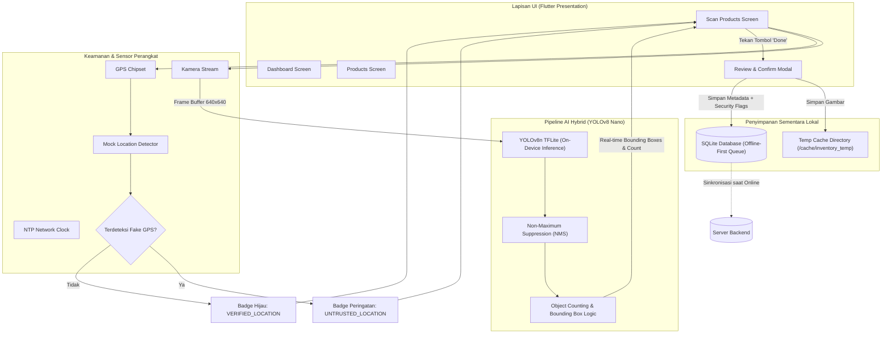

# Implementation Plan: Flutter Inventory App dengan Anti-Fake GPS, AI Object Counting (YOLOv8 Nano), & Temporary Local Storage

Dokumen ini merinci rencana teknis pembuatan aplikasi inventaris Flutter berdasarkan visual referensi [image.png](file:///home/maspati/Dokumen/iventory/image.png) dengan keputusan pengguna yang telah disepakati:
1. **Engine AI**: Arsitektur **Hybrid** dengan optimasi model **YOLOv8 Nano fine-tuned** yang dikonversi ke format TFLite untuk deteksi & penghitungan jumlah barang on-device, dengan opsi verifikasi lanjutan saat capture.
2. **Anti-Fake GPS**: **Sistem Penanda Peringatan (Soft Flag / Audit Warning)** — operasional tidak dihentikan, namun transaksi scan ditandai tidak aman (*untrusted location*) beserta rincian indikator kecurangan.
3. **Penyimpanan Sementara**: Penyimpanan foto di folder *temporary cache* dan pencatatan transaksi audit offline-first di SQLite lokal sebelum sinkronisasi.

---

## 1. Goal Description
Membangun aplikasi inventaris Flutter yang mencakup:
- **3 Tampilan Utama (Sesuai `image.png`)**:
  - **Dashboard**: Ringkasan *Product In* (3027) & *Product Out* (2698), filter periode (1D, 1W, 1M, dll), dan area spline chart revenue interaktif.
  - **Products**: Ringkasan stok gudang, pencarian, tombol scanner, dan daftar kategori produk (*Vegetables*, *Sweet Food*, *Snack [Low Stock]*, *Fruits*).
  - **Scan Products**: Viewfinder pemindai kamera dengan bounding box overlay 3D/reticle dan tombol aksi "Done".
- **Anti-Fake GPS & Integrity Watcher**: Deteksi *Mock Location*, Developer Mode, dan emulator tanpa memblokir aplikasi (memberi penanda peringatan audit).
- **YOLOv8 Fine-Tuned Object Counter (Hybrid Engine)**: Menghitung jumlah barang otomatis secara real-time di layar dan konfirmasi snapshot.
- **Temporary Cache & Offline Queue**: Mengelola penyimpanan lokal foto dan metadata sebelum sinkronisasi ke server pusat.

---

## 2. Arsitektur Teknis & Alur Kerja



---

## 3. Rincian Fitur Teknis

### A. Desain UI (Presisi Sesuai `image.png`)

1. **Dashboard Screen**:
   - Header aplikasi: Judul "Dashboard", ikon kubus 3D/notifikasi dengan badge angka `5`.
   - Kartu Metrik Atas:
     - Kartu Biru (#0075FF): Angka **3027** dengan label **Product In** dan ikon pie chart.
     - Kartu Cyan (#00C2FF): Angka **2698** dengan label **Product Out** dan ikon pie chart.
   - Timeframe Selector: Tab kapsul horizontal (`1D`, `1W` [aktif], `1M`, `3M`, `6M`, `1Y`).
   - Revenue Section:
     - Header revenue: **$27,003.98** dengan badge persentase hijau `+7.6%`.
     - Spline Curved Area Chart (`fl_chart`): Kurva gradien biru halus, sumbu hari (Mo, Tu, We, Th, Fr, Sa, Su), dan active marker titik di hari Friday bernilai **$2,673**.
   - Bottom Navigation Bar: Floating bar dengan 4 ikon: Home (aktif), Folder/Box, Analytics/Chart, Settings.

2. **Products Screen**:
   - Header: Judul "Products", aksi ikon Barcode Scanner dan Search.
   - Ringkasan Metrik:
     - "Total Products": **128** dengan badge `+8.00%` (panah atas hijau).
     - "Stock in Hand": **2,350** dengan badge `+2.34%` (panah atas biru).
   - "Products list" dengan tombol sort/filter toggle.
   - Item List dengan avatar kategori, jumlah masuk/keluar, dan panah navigasi:
     - *Vegetables*: Avatar selada hijau, `▲ 267`, `▼ 149`.
     - *Sweet Food*: Avatar permen lolipop, `▲ 124`, `▼ 87`.
     - *Snack*: Avatar french fries/popcorn, badge persik **Low Stock**, `▲ 88`, `▼ 27`.
     - *Fruits*: Avatar alpukat, `▲ 450`, `▼ 234`.

3. **Scan Products Screen**:
   - Header dengan panah kembali `<` dan judul "Scan Products".
   - Viewfinder Kamera: Frame rounded border dengan animasi laser pemindai biru serta bounding box transparan di atas objek barang.
   - Deskripsi: "Scanning Product" dan subtitle "Scanning result will be automatically add if the item doesn't exist."
   - Floating Counter Bubble: Menampilkan jumlah terdeteksi secara langsung (misal: "📦 8 Items Detected").
   - Action Button: Tombol bulat biru besar **"Done"**.

---

### B. GPS Anti-Spoofing dengan Penanda Peringatan (Soft Flagging)

Sesuai arahan, sistem **tidak memblokir** pengguna agar pekerjaan di lapangan tidak macet, melainkan menyematkan penanda peringatan audit:

1. **Deteksi Multi-Level**:
   - `Location.isFromMockProvider()` dan `Location.isMock()` (Android API 31+).
   - `safe_device` / `trust_location`: Mendeteksi apakah *Developer Options* aktif atau terdapat aplikasi Fake GPS yang terdaftar di OS.
   - Anomali Akurasi & Kecepatan: Mendeteksi akurasi statis buatan (misal radius tepat 0.0m konstan).
2. **Penyajian UI (User Experience)**:
   - Jika terdeteksi Fake GPS: Muncul banner peringatan oranye/kuning di atas layar kamera:
     > ⚠️ **Peringatan Lokasi**: Lokasi perangkat terindikasi tidak asli (Mock GPS). Laporan audit ini akan ditandai untuk ditinjau oleh supervisor.
3. **Audit Data Payload**:
   Setiap transaksi scan menyimpan metadata keamanan:
   ```json
   {
     "latitude": -6.2088,
     "longitude": 106.8456,
     "is_mock_detected": true,
     "security_flags": ["MOCK_PROVIDER_ACTIVE", "DEV_MODE_ENABLED"],
     "trust_level": "WARNING",
     "verified_timestamp": "2026-11-23T11:32:00Z"
   }
   ```

---

### C. Pipeline AI Hybrid & Fine-Tuned YOLOv8 Nano

1. **Mengapa YOLOv8 Nano (`yolov8n`)?**
   - **Ukuran Sangat Ringan**: Model berkisar ~6MB (setelah quantization FP16/INT8), ideal untuk smartphone Android & iOS.
   - **Kecepatan Tinggi**: Inferensi 25–45 FPS pada CPU/GPU mobile menggunakan TFLite runtime.
   - **Akurasi Penghitungan**: Mampu memisahkan barang-barang kemasan yang berjejer atau bertumpuk menggunakan algoritma *Non-Maximum Suppression (NMS)*.
2. **Alur Kerja Hybrid**:
   - **Step 1 (Live Preview)**: Frame kamera (`CameraImage`) di-convert ke tensor RGB `640x640`. Model YOLOv8n TFLite memprediksi bounding box setiap barang secara berkala (misal 5-10 kali per detik untuk hemat baterai).
   - **Step 2 (Viewfinder Overlay)**: Kotak deteksi hijau/biru digambar langsung di atas frame preview bersama angka counter (e.g., `Count: 12`).
   - **Step 3 (Snapshot Confirmation)**: Saat tombol "Done" ditekan:
     - Foto resolusi penuh diambil dan disimpan ke cache.
     - Inferensi snapshot dijalankan untuk menghitung total final.
     - Muncul dialog konfirmasi hasil: Gambar foto + jumlah hitungan + input edit manual jika ada barang di sudut gelap yang terlewat.

---

### D. Temporary Local Storage (Offline-First Cache)

1. **Penyimpanan Gambar**:
   - Disimpan di: `${Directory.temporaryDirectory}/inventory_temp/IMG_${timestamp}_${uuid}.jpg`.
   - File dikompresi ke JPEG kualitas 85% untuk menghemat disk space.
2. **Skema Database Lokal (SQLite / `sqflite`)**:

| Field | Tipe | Keterangan |
|---|---|---|
| `id` | TEXT PRIMARY KEY | UUID transaksi |
| `temp_image_path` | TEXT | Path absolut file foto di cache lokal |
| `detected_count` | INTEGER | Jumlah hitungan hasil AI YOLOv8 |
| `final_count` | INTEGER | Jumlah hitungan setelah konfirmasi user |
| `item_category` | TEXT | Kategori/nama barang |
| `latitude` | REAL | Koordinat lintang |
| `longitude` | REAL | Koordinat bujur |
| `is_mock_detected` | INTEGER | `1` jika Fake GPS, `0` jika asli |
| `security_flags` | TEXT | JSON string daftar flag kecurangan |
| `trust_level` | TEXT | `'VERIFIED'` atau `'WARNING'` |
| `captured_at` | TEXT | Timestamp ISO8601 |
| `sync_status` | TEXT | `'PENDING'`, `'SYNCING'`, `'SYNCED'`, `'FAILED'` |

3. **Mekanisme Siklus Hidup (Cleanup)**:
   - File gambar sementara otomatis dihapus dari memori lokal setelah status berhasil berubah menjadi `'SYNCED'` ke server cloud.

---

## 4. Proposed Code Structure

```
iventory/
├── assets/
│   ├── models/
│   │   ├── yolov8n_inventory.tflite   # Model YOLOv8 Nano hasil fine-tuning
│   │   └── labels.txt                 # Label kelas barang inventaris
│   └── images/                        # Aset ikon visual (sesuai pubspec)
├── lib/
│   ├── main.dart                      # Inisialisasi tema, database, dan router
│   ├── core/
│   │   ├── theme/app_colors.dart      # Warna tema (#0075FF, #00C2FF, #1E293B, dll)
│   │   ├── security/
│   │   │   ├── gps_security_service.dart # Pemeriksaan Mock GPS & Security Flags
│   │   │   └── security_report_model.dart
│   │   └── storage/
│   │       ├── local_cache_manager.dart  # Manajemen direktori & file gambar temporary
│   │       └── inventory_database.dart   # SQLite database & query pending queue
│   ├── features/
│   │   ├── dashboard/
│   │   │   ├── presentation/
│   │   │   │   ├── dashboard_screen.dart # Layar Dashboard (Screen 1)
│   │   │   │   └── widgets/
│   │   │   │       ├── metric_card.dart  # Kartu Product In/Out
│   │   │   │       ├── revenue_spline_chart.dart # FlChart interaktif
│   │   │   │       └── timeframe_pill_selector.dart
│   │   ├── products/
│   │   │   ├── presentation/
│   │   │   │   ├── products_screen.dart  # Layar Daftar Produk (Screen 2)
│   │   │   │   └── widgets/
│   │   │   │       ├── product_category_tile.dart
│   │   │   │       └── stock_indicator_card.dart
│   │   ├── scan/
│   │   │   ├── ml/
│   │   │   │   ├── yolo_detector.dart    # TFLite Interpreter & NMS Processing
│   │   │   │   └── recognition_model.dart # Bounding box & confidence score
│   │   │   ├── presentation/
│   │   │   │   ├── scan_products_screen.dart # Layar Scanner Kamera (Screen 3)
│   │   │   │   ├── widgets/
│   │   │   │   │   ├── scanner_reticle_overlay.dart
│   │   │   │   │   ├── security_warning_badge.dart # Banner peringatan Fake GPS
│   │   │   │   │   └── real_time_counter_chip.dart
│   │   │   │   └── scan_confirm_modal.dart # Dialog konfirmasi hasil hitung
│   │   └── navigation/
│   │       └── main_navigation_shell.dart # Bottom navigation bar persis referensi
```

### Dependencies yang Diperbarui (`pubspec.yaml`):
```yaml
dependencies:
  flutter:
    sdk: flutter
  cupertino_icons: ^1.0.8

  # State & DI
  flutter_riverpod: ^2.5.1

  # UI & Charting
  fl_chart: ^0.68.0
  google_fonts: ^6.2.1

  # Kamera & Image
  camera: ^0.11.0+2
  image: ^4.2.0

  # AI On-Device (YOLOv8 TFLite)
  tflite_flutter: ^0.10.4

  # Keamanan & Lokasi
  geolocator: ^12.0.0
  safe_device: ^1.1.4

  # Storage Sementara & SQLite
  path_provider: ^2.1.3
  sqflite: ^2.3.3+1
  path: ^1.9.0
  intl: ^0.19.0
  uuid: ^4.4.0
```

---

## 5. Verification Plan

### Automated Tests:
1. **Security Flagging Unit Test**:
   - Uji unit `GpsSecurityService`: Berikan mock data dengan `isMocked: true` $\rightarrow$ Pastikan fungsi mengembalikan status `TrustLevel.warning` dan menyertakan flag `MOCK_PROVIDER_ACTIVE` tanpa melempar fatal exception (tidak crash / tidak hard block).
2. **YOLOv8 NMS & Counter Logic Test**:
   - Uji fungsi NMS dengan 20 overlapping bounding boxes $\rightarrow$ Pastikan tereliminasi menjadi jumlah objek sebenarnya dengan threshold IoU 0.45.
3. **Temporary Cache Lifecycle Test**:
   - Uji pembuatan file sementara di direktori cache $\rightarrow$ simpan record di SQLite $\rightarrow$ trigger simulasi sync $\rightarrow$ verifikasi file cache terhapus dengan aman.

### Manual Verification:
1. **Verifikasi UI 3 Layar**:
   - Jalankan aplikasi dan bandingkan langsung dengan [image.png](file:///home/maspati/Dokumen/iventory/image.png):
     - Dashboard: Kartu biru Product In (3027), kartu cyan Product Out (2698), grafik kurva dengan titik pop-up Friday ($2,673).
     - Products: Daftar item sayur, permen, snack (dengan tag Low Stock), buah.
     - Scan: Viewfinder dengan garis pemindai animasi dan tombol Done.
2. **Uji Coba Fake GPS (Soft Warning)**:
   - Aktifkan aplikasi Fake GPS di Android $\rightarrow$ Buka kamera scanner $\rightarrow$ Pastikan muncul banner peringatan kuning di bagian atas scanner $\rightarrow$ Ambil foto $\rightarrow$ Periksa database lokal bahwa kolom `trust_level` bernilai `'WARNING'`.
3. **Uji Coba Penghitungan Objek Kamera**:
   - Letakkan 5 boks/barang di depan kamera $\rightarrow$ Bounding box menandai objek $\rightarrow$ Bubble counter menampilkan "5 Items" $\rightarrow$ Klik "Done" $\rightarrow$ Dialog menampilkan preview foto dengan angka 5 yang dapat disesuaikan.
