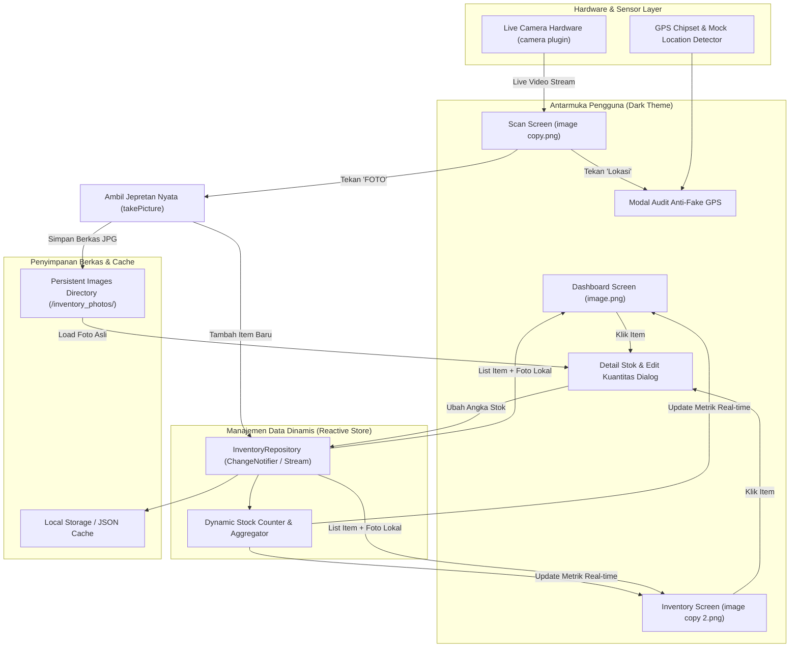

# Rencana Implementasi: Redesain Dark UI, Live Camera Scan, Dinamika Stok & Integrasi Gambar Persisten

Dokumen ini disusun sebagai rencana komprehensif pembaruan aplikasi inventaris Flutter berdasarkan visual referensi [imageplan/](file:///home/maspati/Dokumen/iventory/imageplan/), evaluasi [walkthrough.md](file:///home/maspati/Dokumen/iventory/result/walkthrough.md), serta dua kebutuhan kunci:
1. **Angka Produksi & Stok Dinamis**: Semua metrik stok (*Total Items*, *Low Stock*, *Sale Stock*, *Out of Stock*, serta kuantitas per produk) bersifat dinamis dan dapat diedit kapan saja secara langsung (*real-time reactive state*).
2. **Foto Hasil Simpan Tampil di Detail Stok (Dashboard & Inventory)**: Setiap foto yang diambil saat scan tersimpan secara lokal dan ditautkan ke item stok, sehingga foto asli selalu ditampilkan baik pada thumbnail maupun layar detail stok di Dashboard dan Inventory.

---

## 1. Analisis Masalah & Kebutuhan Pengguna

### A. Evaluasi Masalah Sebelumnya
- **Layar Scan**: Sebelumnya menampilkan ilustrasi vektor kubus/kardus 3D statis (`Icons.inventory_2_outlined`), bukan feed kamera sebenarnya. Harus digantikan dengan integrasi hardware kamera langsung (`camera` plugin) dengan fallback dinamis.
- **Kekakuan Data Stok**: Sebelumnya metrik stok bersifat statis (*hardcoded*). Dibutuhkan arsitektur repository reaktif agar angka stok otomatis terhitung ulang saat stok diedit atau ditambah dari hasil scan.
- **Penyajian Gambar Stok**: Gambar yang telah difoto dan disimpan sebelumnya hanya masuk ke temporary cache tanpa ditampilkan kembali pada daftar item atau kartu detail di Dashboard maupun Inventory.

### B. Referensi Desain Visual Baru ([imageplan/](file:///home/maspati/Dokumen/iventory/imageplan/))
1. **Dashboard Screen** ([image.png](file:///home/maspati/Dokumen/iventory/imageplan/image.png)):
   - Header profil pengguna ("Budi"), toggle dark mode, notifikasi bell.
   - Search bar melengkung.
   - **Metrik 3 Kolom Dinamis**: `SALE STOCK`, `LOW STOCK`, `TOTAL ITEMS`. Angka-angka ini otomatis teragregasi dari data koleksi stok riil.
   - **Daftar Aktivitas Stok**: Menampilkan thumbnail **foto asli barang** yang tersimpan, nama komoditas, PIC & timestamp, serta indikator seleksi. Saat item diklik, memunculkan modal/layar detail lengkap dengan foto jepretan asli dan opsi edit kuantitas stok.
   - Navigasi bawah: `Home`, `Scan`, `Inventory`.

2. **Scan Products Screen** ([image copy.png](file:///home/maspati/Dokumen/iventory/imageplan/image%20copy.png)):
   - Header: Tombol silang `[X]` dan judul *"Scan"*.
   - Viewfinder Kamera: Full viewport dengan live feed kamera asli (bukan mockup kardus).
   - Tombol Bawah:
     - **FOTO** (`#707BFB`): Mengambil jepretan riil, mendeteksi objek dengan AI, serta membuka modal konfirmasi untuk menyimpan foto dan menentukan jumlah stok.
     - **Lokasi** (`#9AA5FF`): Membuka panel sheet audit Anti-Fake GPS (koordinat, deteksi mock location, dan tanda tangan integritas SHA-256).

3. **Inventory Screen** ([image copy 2.png](file:///home/maspati/Dokumen/iventory/imageplan/image%20copy%202.png)):
   - Header: Tombol kembali `[<]` dan judul *"Inventory"*.
   - Filter Chips: `All Items`, `Low Stock`, `Sale Stock`.
   - **Metrik 3 Kolom Dinamis**: `OUT OF STOCK`, `LOW STOCK`, `TOTAL ITEMS`.
   - Section Header: `ACTIVE INVENTORY` dengan total counter dinamis dan aksi `Export CSV >`.
   - **Daftar Barang & Foto Persisten**: Menampilkan thumbnail foto asli produk, nama, kategori, gudang, kuantitas satuan dinamis, dan tanggal kadaluarsa. Mengklik item membuka lembar detail untuk melihat foto ukuran penuh dan mengedit jumlah stok.

---

## 2. Arsitektur Teknis & Alur Data



---

## 3. Desain Model Data Dinamis

```dart
class InventoryItem {
  final String id;
  String name;
  String category;
  String warehouse;
  int quantity;            // <-- Dinamis: dapat diedit kapan saja
  int lowStockThreshold;   // Batas peringatan low stock (misal: <= 100)
  bool isForSale;          // Penanda sale stock
  String? unit;            // e.g. "cases", "bags", "boxes", "kg"
  String? packageDetail;   // e.g. "12 oz cans", "4-finger bar"
  DateTime? expirationDate;// e.g. Exp 08/27
  String? imagePath;       // <-- Path lokal foto jepretan kamera asli
  DateTime updatedAt;
  String updatedBy;        // e.g. "Luqman", "Budi Santoso"
  GpsSecurityReport? auditGps; // Jejak audit anti-fake GPS saat pengambilan foto
}
```

### Logika Metrik Dinamis Otomatis:
- **TOTAL ITEMS**: `sum(items.map((e) => e.quantity))` atau `items.length` (disediakan toggle/tampilan keduanya).
- **LOW STOCK**: `items.where((e) => e.quantity <= e.lowStockThreshold && e.quantity > 0).length`.
- **OUT OF STOCK**: `items.where((e) => e.quantity == 0).length`.
- **SALE STOCK**: `items.where((e) => e.isForSale).length`.

Ketika pengguna mengubah kuantitas stok suatu barang pada dialog edit:
1. State langsung memberi notifikasi (`notifyListeners()`).
2. Seluruh metrik di Dashboard dan Inventory seketika ter-render ulang tanpa perlu me-reload aplikasi.
3. Foto yang tersimpan di `imagePath` dimuat menggunakan `Image.file(File(item.imagePath!))` dengan fallback visual jika file tidak ditemukan.

---

## 4. Rincian Modul & Tahapan Implementasi

### Tahap 1: Setup Dependensi Kamera & Image Persistence
1. **Dependensi di [pubspec.yaml](file:///home/maspati/Dokumen/iventory/pubspec.yaml)**:
   - `camera: ^0.11.0` (Hardware live camera capture).
   - `path_provider` & `path` (Penyimpanan foto jepretan ke direktori aplikasi).
2. **Konfigurasi Izin Platform**:
   - `android/app/src/main/AndroidManifest.xml`: Izin `CAMERA`, `READ_EXTERNAL_STORAGE`, `WRITE_EXTERNAL_STORAGE`.
3. **Adaptive Camera Controller**:
   - Inisialisasi kamera belakang (`CameraLensDirection.back`).
   - Sediakan fallback dinamis (simulasi feed interaktif / galeri foto) jika dijalankan di emulator atau Linux Desktop tanpa modul kamera fisik.

### Tahap 2: Manajemen State Dinamis ([inventory_repository.dart](file:///home/maspati/Dokumen/iventory/lib/core/repository/inventory_repository.dart))
1. Membuat `InventoryRepository` berbasis `ChangeNotifier` sebagai *single source of truth*.
2. Memuat item awal (*initial seed items*) yang mencerminkan komoditas dari `image.png` dan `image copy 2.png`.
3. Metode:
   - `updateStockQuantity(String itemId, int newQuantity)`: Mengubah kuantitas stok secara dinamis.
   - `addNewItemFromScan(...)`: Menyimpan foto hasil jepretan ke penyimpanan permanen dan menambahkan item baru ke daftar.
   - `deleteItem(String itemId)`.
   - Getter metrik agregasi: `totalItemsCount`, `lowStockCount`, `outOfStockCount`, `saleStockCount`.

### Tahap 3: Pembaruan Tema Gelap ([app_theme.dart](file:///home/maspati/Dokumen/iventory/lib/core/theme/app_theme.dart))
- Background: `#111315` / `#16181B`.
- Surface Card: `#1D1F24` dengan border halus `#2A2D34`.
- Accent Utama (Tombol FOTO): `#707BFB` / `#7B88FF`.
- Accent Sekunder (Tombol Lokasi): `#9AA5FF` / `#A5B4FC`.
- Text: Putih `#FFFFFF` dan abu-abu `#8D919D`.

### Tahap 4: Implementasi Layar Scan Kamera & Lokasi ([image copy.png](file:///home/maspati/Dokumen/iventory/imageplan/image%20copy.png))
1. **Viewfinder Nyata**: Widget `CameraPreview` mengisi layar penuh.
2. **Tombol FOTO**:
   - Mengambil jepretan asli (`controller.takePicture()`).
   - Menyimpan berkas gambar ke folder permanen aplikasi.
   - Menjalankan deteksi AI (YOLO object counter) untuk estimasi jumlah awal.
   - Memunculkan dialog penyimpanan untuk memberi nama barang, memilih kategori, dan memverifikasi jumlah stok.
3. **Tombol Lokasi**:
   - Membuka modal sheet audit GPS: menampilkan status Anti-Fake GPS, koordinat saat ini, mock location status, dan SHA-256 integrity signature.

### Tahap 5: Implementasi Layar Dashboard ([image.png](file:///home/maspati/Dokumen/iventory/imageplan/image.png))
1. Top bar profil Budi, dark mode switch, notifikasi.
2. Search bar interaktif dengan filter pencarian real-time.
3. 3-slot dynamic metrics card (`SALE STOCK`, `LOW STOCK`, `TOTAL ITEMS`).
4. List stok barang:
   - **Thumbnail Foto Asli**: Menampilkan `Image.file` dari foto yang tersimpan (atau placeholder grid jika foto belum diunggah).
   - Nama produk, PIC & waktu update.
   - Tombol klik yang membuka **Item Detail & Edit Dialog** (menampilkan foto jepretan besar, status stok, dan tombol edit kuantitas stok `+` / `-`).

### Tahap 6: Implementasi Layar Inventory Detail ([image copy 2.png](file:///home/maspati/Dokumen/iventory/imageplan/image%20copy%202.png))
1. Header tombol kembali dan judul *"Inventory"*.
2. Filter chips: `All Items`, `Low Stock`, `Sale Stock`.
3. 3-slot dynamic metrics card (`OUT OF STOCK`, `LOW STOCK`, `TOTAL ITEMS`).
4. Subheader `ACTIVE INVENTORY` dengan total dinamis dan tombol `Export CSV >`.
5. List kartu produk:
   - **Thumbnail Foto Asli** yang tersimpan di memori.
   - Kategori produk, lokasi gudang, detail kemasan, dan tanggal expired.
   - Klik kartu membuka **Item Detail & Edit Modal** untuk mengubah jumlah stok kapan saja serta melihat foto resolusi penuh.

---

## 5. Saran & Opsi Tindak Lanjut

1. **Opsi 1 (Disarankan — Eksekusi Penuh / End-to-End)**:
   - Integrasikan `camera` plugin + penyimpanan file foto lokal.
   - Implementasikan `InventoryRepository` reaktif (angka stok dinamis & terhitung otomatis saat diedit).
   - Terapkan 3 layar dark UI sesuai `imageplan/` dengan penautan foto di Dashboard dan Inventory serta modal edit kuantitas stok.
   - Hubungkan tombol FOTO (capture foto + AI counting) dan tombol Lokasi (Anti-Fake GPS audit modal).

2. **Opsi 2 (Bertahap — State Dinamis & Tampilan Foto Dahulu)**:
   - Menyelesaikan model data dinamis, pemuatan foto pada Dashboard dan Inventory, serta dialog edit stok, sebelum mengkonfigurasi integrasi native kamera Android.

3. **Opsi 3 (Eksekusi Penuh + Fitur Ekspor CSV Riil)**:
   - Melakukan seluruh Opsi 1 ditambah pembuatan file CSV riil yang dapat diunduh/dibagikan saat pengguna menekan tombol `Export CSV >`.
